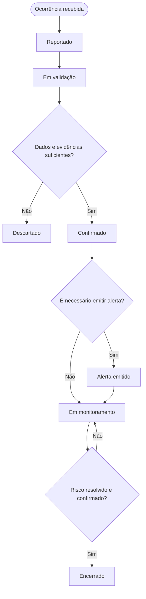

# 🛡️ UrbanGuard
### Urban Risk Intelligence Platform

**Global Solution 2026.2 | FIAP | Engenharia de Software**

Plataforma acadêmica de monitoramento e análise de riscos urbanos.

---

## 🌆 Sobre o projeto

O **UrbanGuard** foi concebido para centralizar informações sobre riscos cotidianos em áreas urbanas, como alagamentos, ilhas de calor e interrupções de energia, água e transporte. A proposta, desenvolvida no contexto do desafio **CitizenTech** da **Global Solution 2026.2**, é apoiar moradores e agentes locais na consulta de ocorrências e na compreensão da gravidade, da origem e da confiabilidade das informações.

* **Objetivo geral:** Apresentar um protótipo navegável de uma plataforma para visualizar, registrar e priorizar ocorrências urbanas, facilitando o acompanhamento e a comunicação de alertas.

---

## 🔗 Links do projeto

| Material | Acesso |
| :--- | :--- |
| **Protótipo navegável** | https://www.figma.com/make/EwHlMizgZ9omeVqLf7jbO8/UrbanGuard-Risk-Platform?t=1qLUcnRVGtsuQlL1-1 |
| **Documentação técnica e diagramas** | https://miro.com/app/board/uXjVEONtu40=/?share_link_id=459181003457 |

---

## 🧭 Funcionalidades

O protótipo reúne **10 telas/módulos**:

| Tela | Finalidade |
| :--- | :--- |
| **Login** | Acesso demonstrativo à plataforma |
| **Dashboard** | Indicadores de alertas, áreas críticas, serviços interrompidos e confiabilidade |
| **Mapa de Riscos** | Localização e visualização dos eventos urbanos |
| **Central de Alertas** | Consulta de alertas por categoria, gravidade e estado |
| **Detalhes do Alerta** | Informações completas, origem e nível de confiança |
| **Notificações** | Comunicados sobre novos alertas e atualizações |
| **Registro Comunitário** | Formulário para relatos de moradores |
| **Origem dos Dados** | Transparência sobre fontes e critérios de confiabilidade |
| **Histórico** | Acompanhamento do ciclo de vida das ocorrências |
| **Configurações** | Preferências de notificação, regiões e privacidade |

---

## 🔄 Fluxo das ocorrências

O processo proposto começa com o recebimento de dados de sensores, bases públicas ou registros comunitários, seguido de validação, classificação e eventual emissão de alerta.



> **Regra essencial:** Um relato comunitário não gera automaticamente um alerta público. Primeiro ele passa pela validação. O fluxo acima descreve o comportamento proposto e é representado no protótipo com dados e interações simulados.

---

## 📊 Regras de classificação

As fórmulas abaixo foram definidas para o modelo acadêmico e **não são critérios oficiais da Defesa Civil**.

### Nível de risco

```text
Risco = (Severidade × 0,40) + (População afetada × 0,35) + (Urgência × 0,25)
```

| Pontuação | Classificação |
| :---: | :--- |
| `0–24` | 🟢 **Baixo** |
| `25–49` | 🟡 **Moderado** |
| `50–74` | 🟠 **Alto** |
| `75–100` | 🔴 **Crítico** |

### Nível de confiança

```text
Confiança = (Confiabilidade da fonte × 0,40) + (Atualidade × 0,30) + (Corroboração × 0,30)
```

| Pontuação | Classificação |
| :---: | :--- |
| `0–39` | **Baixa** |
| `40–69` | **Média** |
| `70–100` | **Alta** |

*Cada fator das fórmulas recebe uma nota entre 0 e 100. A confiança e o risco devem ser reavaliados quando houver novas evidências.*

---

## 🏗️ Documentação e arquitetura

A documentação técnica está organizada no **Miro** e contempla:

1. Apresentação do projeto, problema e objetivos.
2. Público-alvo e três personas.
3. 15 requisitos funcionais (`RF01–RF15`).
4. 10 requisitos não funcionais, classificados conforme `ISO/IEC 25010`.
5. 10 regras de negócio (`RN01–RN10`).
6. Diagrama UML de Sequência, do recebimento à notificação.
7. Diagrama UML de Estados, do registro ao encerramento ou descarte.
8. Arquitetura em camadas, com fontes externas e segurança transversal.

### Arquitetura proposta

| Camada | Responsabilidade |
| :--- | :--- |
| **Apresentação** | Interface web, dashboard, mapa, alertas, notificações e registro comunitário |
| **Aplicação e negócio** | Recebimento, validação, classificação de risco/confiança e notificações |
| **Dados** | Persistência de ocorrências, usuários, eventos, alertas e auditoria |
| **Segurança e privacidade** | Controles transversais de acesso, proteção de dados e LGPD |

*A arquitetura descreve uma possível implementação futura. A existência desses componentes no diagrama não significa que servidores, bancos de dados ou APIs reais estejam implementados.*

---

## ▶️ Como acessar e demonstrar

Não é necessário instalar dependências ou executar um backend local para apresentar a entrega de Engenharia de Software:

1. Abra o protótipo no **Figma Make**.
2. Inicie pela tela de **login demonstrativa**.
3. Navegue pelo **Dashboard**, pelo **Mapa de Riscos** e pela **Central de Alertas**.
4. Abra os **detalhes de um evento** e observe origem e nível de confiança.
5. Acesse **Registro Comunitário** e demonstre o cadastro simulado de uma ocorrência.
6. Consulte o **Histórico** e o fluxo de validação, conforme disponível na versão publicada do protótipo.
7. Abra o quadro do **Miro** para apresentar requisitos, diagramas UML e arquitetura.

---

## 🛠️ Ferramentas utilizadas

| Ferramenta | Utilização |
| :--- | :--- |
| **Figma Make** | Desenvolvimento do protótipo navegável |
| **Miro** | Documentação técnica e diagramas |
| **UML** | Modelagem do fluxo de sequência e dos estados da ocorrência |
| **Markdown** | Documentação do repositório no GitHub |

---

## 🔒 Segurança e LGPD

O **UrbanGuard** considera em seus requisitos e arquitetura proposta princípios da **Lei Geral de Proteção de Dados Pessoais (Lei nº 13.709/2018)**, incluindo finalidade, necessidade, transparência, prevenção, rastreabilidade e segurança.

*Não foram realizados testes de segurança, carga ou disponibilidade em um ambiente de produção.*

---

## 👥 Integrantes

| Nome | RM |
| :--- | :---: |
| **Victor Augusto Ribeiro de Oliveira** | `558338` |
| **Pedro Henrique Garcia** | `558867` |

* **Instituição:** FIAP
* **Curso:** Engenharia da Computação
* **Turma:** 3ECR
* **Disciplina:** Engenharia de Software
* **Semestre:** 2026.2
